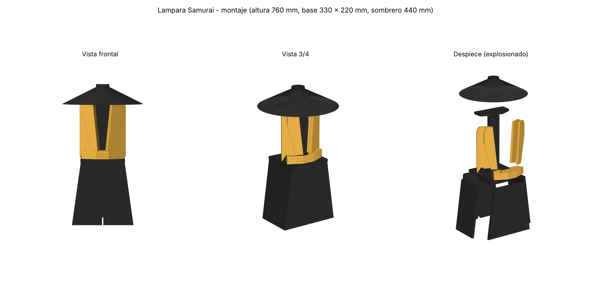
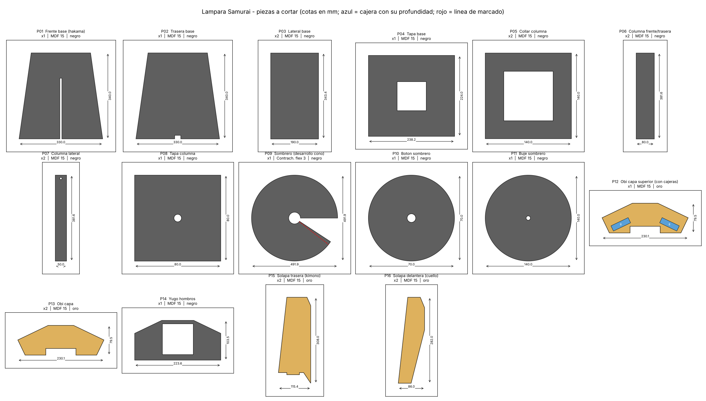

# Lámpara Samurái – piezas y programas CNC

Lámpara escultórica estilo samurái (sombrero cónico negro, kimono dorado, *hakama* negra) despiezada en tablero plano para router CNC.



**Medidas generales:** alto 760 mm · base 330 × 220 mm · sombrero Ø440 mm.

## Piezas



| ID | Pieza | Cant. | Material | Medida (mm) | Color | Notas |
|---|---|---|---|---|---|---|
| P01 | Frente base (hakama) | 1 | MDF 15 | 330 × 340 | negro | ranura central 8 mm = dos "piernas" |
| P02 | Trasera base | 1 | MDF 15 | 330 × 340 | negro | muesca 24×14 salida de cable |
| P03 | Lateral base | 2 | MDF 15 | 190 × 343.4 | negro | va inclinado 8°, entre frente y trasera |
| P04 | Tapa base | 1 | MDF 15 | 238.2 × 224 | negro | ventana 80.5 para la columna |
| P05 | Collar columna | 2 | MDF 15 | 140 × 140 | negro | se encolan bajo la tapa |
| P06 | Columna frente/trasera | 2 | MDF 15 | 80 × 381.6 | negro | |
| P07 | Columna lateral | 2 | MDF 15 | 50 × 381.6 | negro | taladro Ø10 (cable LED); en una basta |
| P08 | Tapa columna | 1 | MDF 15 | 80 × 80 | negro | taladro Ø7 + inserto M6 |
| P09 | Sombrero (desarrollo del cono) | 1 | **Contrachapado flexible 3** | 491.9 × 491.9 | negro | sector 322° + 20 mm de solape (línea marcada) |
| P10 | Botón sombrero | 1 | MDF 15 | Ø70 | negro | |
| P11 | Buje sombrero | 1 | MDF 15 | Ø140 | negro | se encola bajo el cono |
| P12 | Obi capa superior | 1 | MDF 15 | 230.1 × 79.5 | oro | 2 cajeras de 8 mm |
| P13 | Obi capa | 2 | MDF 15 | 230.1 × 79.5 | oro | |
| P14 | Yugo hombros | 1 | MDF 15 | 223.6 × 103.5 | negro | cantos inclinados sujetan P15 |
| P15 | Solapa trasera (kimono) | 2 | MDF 15 | 115.4 × 308 | oro | cortar 2 iguales, la izquierda se voltea |
| P16 | Solapa delantera (cuello) | 2 | MDF 15 | 86 × 282 | oro | se encola sobre P15 |

Total: 21 piezas (20 en MDF 15 mm — caben de sobra en medio tablero 1220 × 1220 — y 1 en contrachapado flexible 3 mm de 500 × 500).

## Programas NC (`nc/`)

Un `.nc` por pieza. **Formato copiado del ejemplo `.nc` que entrega el fabricante (Chaoda) para esta máquina:**
números de línea `N`, palabras separadas por espacio, `S… M3` al inicio, primer movimiento `G0 G54 X… Y…`,
código modal (`X-.865 Z284.`), avance entero (`F1500`), sin comentarios, sin arcos G2/G3 (los taladros van en hélice con rectas),
final `G53 Z0` / `G0 M05` / `M30` / `%`, saltos de línea CRLF. No se usa el eje B (corte plano en 3 ejes).
Si una pieza tiene cantidad 2, se ejecuta el programa dos veces.

| Parámetro | Valor |
|---|---|
| Herramienta | T1 fresa plana Ø6 mm (2 cortes; compresión ideal en MDF) |
| Husillo | S18000 (los ejemplos traen S1500: confirmar qué usa la máquina) |
| Avance XY / Z | 1500 / 500 mm/min (ejemplo del fabricante: 5000 / 1000) |
| Altura seguridad | Z10 |
| Pasada | 5 mm en MDF 15 (3 pasadas), 1.8 mm en 3 mm |
| Profundidad | espesor + 0.3 mm (al tablero mártir) |
| Puentes | 3–6 por pieza, 8 mm de ancho, 3 mm alto (1.2 en el sombrero) |
| Origen | **X0 Y0 = esquina inferior izquierda de la pieza** (deja ≥10 mm de margen al borde del tablero) · **Z0 = cara superior del tablero**, todo en **G54** |

Orden dentro de cada programa: taladros (helicoidal) → marcado → cajeras → cortes interiores (con *dogbones* en las esquinas para que entre la pieza cuadrada) → contorno exterior en concordancia con puentes.

`img/trayectorias.png` es el backplot leído de los propios `.nc` para verificarlos.
En `dxf/` está cada pieza en DXF (capas CORTE_EXT, CORTE_INT, CAJERA, TALADRO, MARCADO) por si prefieres generar el CAM en tu software (Aspire, Fusion, etc.).

## Montaje

1. **Base:** encolar P03 (inclinados) entre P01 y P02. Encolar los dos P05 bajo P04 (centrados en la ventana) y P04 encima de las paredes.
2. **Columna:** caja con P06 (fuera) y P07 (dentro), tapa P08 arriba con inserto roscado M6. Introducirla por la ventana de P04 hasta el fondo de los collares (45 mm) y encolar.
3. **Obi:** apilar P13 + P13 + P12 (cajeras arriba), encajar alrededor del frente de la columna sobre P04.
4. **Yugo:** P14 deslizar por la columna hasta 650 mm del suelo (su canto superior a 665).
5. **Kimono:** P16 encolado sobre la cara frontal de P15 (alineando bordes inferior e interior). La espiga de P15 entra en la cajera del obi y su cara trasera se encola al canto inclinado del yugo. La pieza izquierda es la misma volteada.
6. **Sombrero:** curvar P09 hasta el solape marcado y encolar (cono). Encolar P11 por dentro bajo el cono. Atornillar con M6×70: P10 (arriba) → cono → P11 → inserto de P08. Desmontable para acceder a la luz.
7. **Luz:** tira LED COB 24 V blanca cálida (2700 K) alrededor de la columna entre 670–690 mm (bajo el sombrero), cable por el taladro de P07, por dentro de la columna hasta la fuente dentro de la base, salida por la muesca de P02.
8. **Acabado:** sellador para cantos de MDF, lijar, negro mate y dorado (o pan de oro) en P12, P13, P15, P16.

## Modificar el diseño

Todo es paramétrico (`geometria.py`: medidas; `cam.py`: herramienta, avances, puentes).

```bash
pip install -r requirements.txt
python3 geometria.py   # lista de piezas
python3 dibujos.py     # img/montaje.png e img/piezas.png
python3 cam.py         # nc/*.nc y dxf/*.dxf
python3 backplot.py    # img/trayectorias.png (verificación)
```
