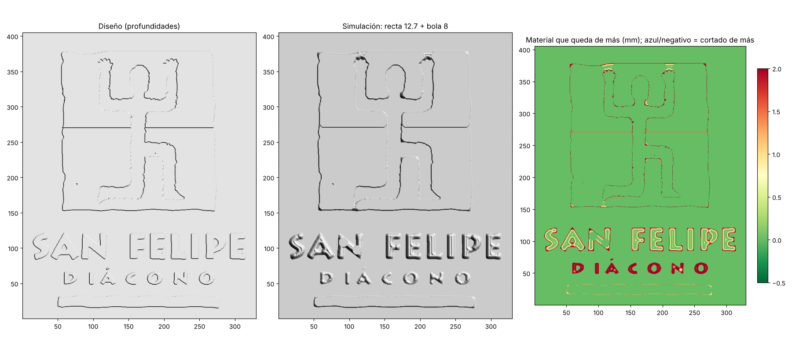

# Logo San Felipe Diácono, prueba en MDF de 12 mm

**Pieza:** 330 × 406 mm, con el logo de 300 mm de ancho y 15 mm de margen.

## Qué se talla
| Zona | Profundidad |
|---|---|
| Verde del cuadro (suelo y cielo) | 2.5 mm |
| Cielo (verde oscuro) | 4.0 mm, así se ve el horizonte |
| Letras | 3.0 mm. «DIÁCONO» sale como un canal por el centro de cada trazo, porque la bola no cabe a fondo |
| Barra naranja de abajo | 1.5 mm, para pintarla |
| Marco, figura y fondo blanco | Quedan en la cara del MDF |

Las paredes salen redondeadas con el radio de la fresa bola. Después se pinta: verde dentro de las cajeras, naranja en la figura y el marco.

## Programas (`nc/`), en este orden
Cada programa es para una sola fresa. Cambia de fresa entre uno y otro.

| # | Archivo | Fresa | Qué hace |
|---|---|---|---|
| 1 | `1_desbaste_recta_12.7mm.nc` | Recta 1/2" (12.7 mm) | Vacía las cajeras grandes y deja 0.25 mm en las paredes. |
| 2 | `2_detalle_bola_8mm.nc` | Bola de **8 mm** | Paredes, rincones y trazos estrechos. |
| 3 | `3_corte_recta_12.7mm.nc` | Recta 1/2" | Recorta la pieza a 12.3 mm de profundidad, con 4 puentes de 2 mm. |

**Tiempo aproximado:** unos 4 + 27 + 3 minutos de corte.

**Avances:**
- Recta: F2500, bajadas a F700, en rampa. Pasos de 3 mm.
- Bola: F2000 y F500. Pasos de 1.5 mm.

**Husillo:** S18000.

## Antes de cortar
- **Diámetro de la bola.** El programa 2 supone una bola de **8 mm**.
  - Si la tuya es más pequeña, solo queda algo de material de más.
  - Si es **más grande, se come los bordes**.
  - Para otra medida: `python3 logo.py --bola 6`, y comprueba con `python3 verificar.py --bola 6`.
- **Fresa recta.** Comprueba que su parte cortante mide 1/2" (12.7 mm) y que tienes pinza de 1/2" para su caña.
- **Sujeción.** Sujeta bien el MDF y pon debajo un tablero de sacrificio: el corte pasa 0.3 mm por debajo.
- **Cero de cada fresa.**
  - X0 Y0 en la esquina inferior izquierda de la pieza.
  - Z0 en la cara de arriba del MDF, **otra vez con cada fresa**.
  - Los programas llevan `G43 H1`: revisa H1 como en `../prueba_maquina`.
- **Prueba en el aire.** Haz primero una pasada en el aire con Z0 unos 20 mm más arriba.

## Verificación
`verificar.py` lee los NC y comprueba de forma exacta, con shapely, que en ningún movimiento la fresa entra en material que debe quedar. Usa la forma real de cada fresa: plana o bola. También comprueba los G0 por encima del MDF, la Z mínima y el formato. Además simula el resultado para dibujar `img/simulacion.png`.

**Último resultado:** 0 problemas en los tres programas.
