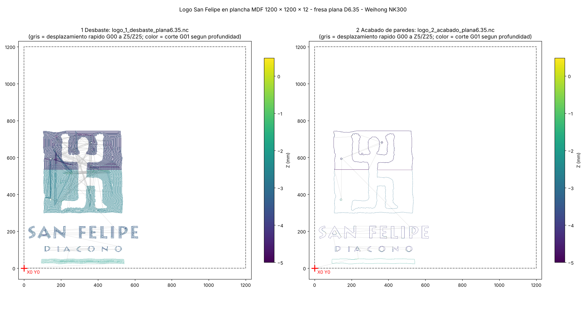
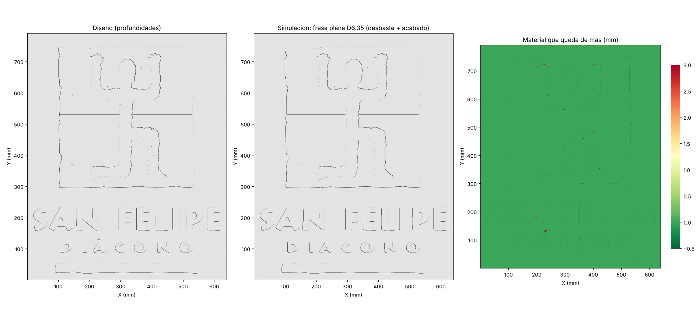

# Logo San Felipe Diácono para Weihong NK300 (fresa plana)

Grabado y relieve del logo en una plancha de **MDF de 1200 × 1200 × 12 mm**:
- **Logo:** 600 mm de ancho y 751 mm de alto.
- **Posición:** esquina inferior izquierda del logo a 20 mm de la esquina de la plancha. Ocupa X 20…620 e Y 20…771.
- **Recorte:** no se recorta la pieza, solo se graba.

## Herramienta (única, sin cambio automático)
| | |
|---|---|
| **Tipo** | Fresa plana helicoidal de 2 filos. No hay trayectorias de bola. |
| **Diámetro** | Medido: 6 mm. Es una fresa de **1/4" = 6.35 mm**, y los programas usan **6.35 mm**. Si la fresa mide 6.00, en cada pared queda 0.18 mm de material de más. |
| **Pinza** | **ER de 6–7 mm o de 1/4"**. ⚠ La pinza ER 7–8 mm **no sujeta bien** una caña de 6.35 mm: la fresa puede soltarse. |
| **Largo** | 12 cm en total. La profundidad máxima del trabajo es 5 mm. |

## Programas (`nc_nk300/`), con la misma fresa y el mismo cero
| # | Archivo | Qué hace | Tiempo aprox. |
|---|---|---|---|
| 1 | `logo_1_desbaste_plana6.35.nc` | Vacía las cajeras por niveles. Deja 0.3 mm en las paredes y entra siempre en rampa. | ~84 min |
| 2 | `logo_2_acabado_plana6.35.nc` | Repasa cada pared a la medida exacta, a fondo. | ~9 min |

El tiempo es el de corte más los desplazamientos rápidos, sin contar las aceleraciones: en la máquina será algo mayor. Confírmalo con la simulación del NcStudio.

**Profundidades** (fondo plano):
| Zona | Profundidad |
|---|---|
| Verde | 3 mm |
| Cielo (verde oscuro) | 5 mm |
| Letras | 4 mm |
| Barra | 2 mm |
| Marco, figura y blanco | Quedan en Z0 |

## Parámetros (MDF, fresa de 6.35 mm, 2 filos)
| Parámetro | Valor | Por qué |
|---|---|---|
| Husillo | S18000 | 9 kW, máximo 24000 rpm. |
| Avance XY | F2200, acabado F1800 | 0.06 mm por diente × 2 filos × 18000 rpm. |
| Avance Z / rampas | F650 | |
| Entrada | Rampa 1:10 (unos 6°) siguiendo el camino | Nunca baja en vertical en material sin cortar. |
| Profundidad por pasada | 2.0 mm | Aproximadamente 0.3 × D. |
| Paso lateral (desbaste) | 2.86 mm | 45 % de D. |
| Sobremedida de paredes | 0.3 mm | La quita el acabado. |
| Z de seguridad / traslado | 25 mm / 5 mm sobre la madera | Si las bridas son más altas de 20 mm, sube `safe_z` y `travel_z`. |

Para otro diámetro: `python3 logo_nk300.py --fresa D` y después `python3 verificar_nk300.py --fresa D`.

## Formato NK300
Esto sale de la investigación del manual de NcStudio y los posts de Weihong:
- **Cabecera:** `G90 G21 G17 G40 G80` y `G54`.
- **Arranque:** `G00 Z25` antes de cualquier movimiento en XY, después `M03 S18000` y `M00`, una pausa para comprobar que el husillo gira a régimen. Pulsa marcha para seguir.
- **Final:** `G00 Z25`, `M05`, `G00 X0 Y0` (esquina de la plancha) y `M30`.
- **Formato:** texto ASCII con fin de línea CRLF. Los comentarios van en su propia línea. Los números llevan siempre punto decimal (`Z-0.500`, `F2200.0`).
- **Lo que no se emite:** `%`, `N`, `T`, `M06` (evita el cambio automático), `G43`/`G49`/`H`, `M07`–`M09`, `M71`/`M73`, `G28`, `G53` ni `G04`.

## Antes de cortar
1. **Pinza:** pon una pinza del diámetro correcto (6–7 mm o 1/4").
2. **Plancha:** fíjala bien. Con vacío o bridas fuera de la zona X 0…660, Y 0…810.
3. **Cero:** X0 Y0 en la esquina inferior izquierda de la plancha. Z0 tocando la cara de arriba con esta misma fresa, en **G54**.
4. **Simulación:** carga el NC en NcStudio y revisa la simulación o el trazado.
5. **Pasada en el aire:** desplaza el cero Z unos 25 mm hacia arriba y corre el programa 1.
6. **Corte:** corre el **1** y después el **2**, sin tocar la fresa ni el cero.

## Verificación hecha
`verificar_nk300.py`:
- **Formato:** ASCII, CRLF, ningún código prohibido, números con punto, cabecera y final seguros.
- **Desplazamientos:** ningún `G00` en XY por debajo de Z1 y todo dentro de la plancha.
- **Profundidad:** la Z mínima es -5.
- **Cortes de más:** comprobación exacta con la fresa plana real (shapely) de que no se corta fuera del diseño.

**Resultado:** 0 problemas. El único material de más está donde una fresa de 6.35 no cabe: rincones interiores de radio 3.2 mm, dedos de la figura y la tilde de la Á.
