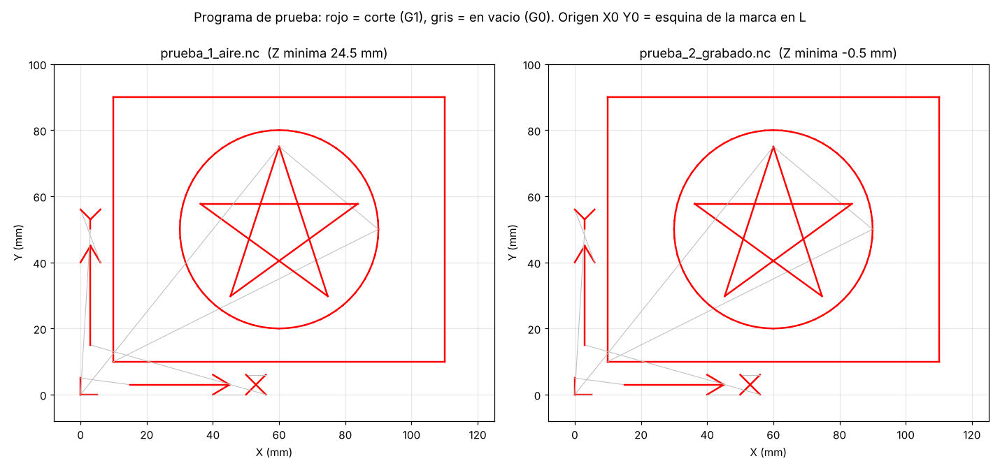

# Programa de prueba de la máquina

Dibujo de 120 × 100 mm para comprobar que la router Chaoda lee bien los `.nc` antes de cortar piezas de verdad.

| Archivo | Qué hace |
|---|---|
| `nc/prueba_1_aire.nc` | El dibujo completo **25 mm por encima del tablero**. La fresa no toca nada. |
| `nc/prueba_2_grabado.nc` | El mismo dibujo grabado a **0.5 mm** de profundidad, en un retazo. |

## Contenido del dibujo
- **Marco:** 100 × 80 mm. Mídelo con una regla para comprobar la escala.
- **Círculo:** Ø60 mm. Comprueba que sale redondo y no ovalado.
- **Estrella:** 5 puntas inscrita en el círculo.
- **Flechas +X y +Y con sus letras:** comprueban el sentido de los ejes. Si una flecha apunta al lado contrario de lo que esperas, ese eje está invertido.
- **Marca en L:** está en el origen **X0 Y0**.

## Cómo probar
1. **Fresa:** pon una fresa en V o una plana pequeña, de 3 mm o menos.
2. **Cero:** fija X0 Y0 en la esquina inferior izquierda del retazo, con unos 10 mm de margen. Fija Z0 tocando la cara de arriba del retazo. Todo en **G54**.
3. **Revisa H1 antes de nada.** El programa usa `G43 H1`, que suma el largo guardado en la tabla de herramientas, en H1, a todas las Z.
   - Si fijaste Z0 en G54 tocando el retazo **con la fresa puesta**, como se hace normalmente con el palpador, **H1 debe valer 0**. Si no, todo el programa queda desplazado ese valor y puede clavarse o cortar en el aire.
   - Si tu máquina trabaja con largos de herramienta en H1, fija Z0 como lo hacías con PowerMill.
   - La prueba en el aire sirve justo para comprobarlo: la fresa debe quedar unos 24.5 mm por encima del retazo mientras dibuja.
4. **La máquina debe estar arriba al empezar**, por ejemplo después del home o de un `G53 Z0`. Como en el post, el primer movimiento va a X/Y a la altura a la que esté la máquina, y solo después baja a Z10.
5. **Prueba en el aire:** corre primero `prueba_1_aire.nc`. Mira que haga el dibujo completo y que termine subiendo y apagando el husillo. Ten la mano en el paro de emergencia.
6. **Grabado:** si todo va bien, corre `prueba_2_grabado.nc`.

## Datos del programa
- **Husillo:** S18000. El ejemplo del fabricante usa S1500. Si tu máquina espera otro valor, cambia `SPINDLE` en `prueba.py` y vuelve a generar.
- **Avances:** F1000 en XY y F300 al bajar en Z. La altura de seguridad es Z10.
- **Inicio, como en el post de PowerMill** (`../maquina/POST-4axis-table-B.opt`): `G40 G17 G80 G49 G90`, `M71`, `M73`, `S… M3`, `G0 G54 X… Y…`, `G43 H1`, `G90` y, después, `Z10.`.
- **Resto del formato:** el del ejemplo del fabricante (`rough-1.nc`). Números de línea N, sin comentarios ni arcos, final `G53 Z0`, `G0 M05`, `M30` y `%`, saltos de línea CRLF.

Para regenerar: `python3 prueba.py`. Para revisar: `python3 verificar.py`, que comprueba los límites y redibuja `img/trayectoria.png`.
